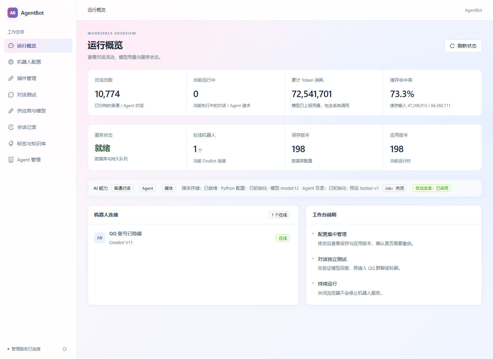
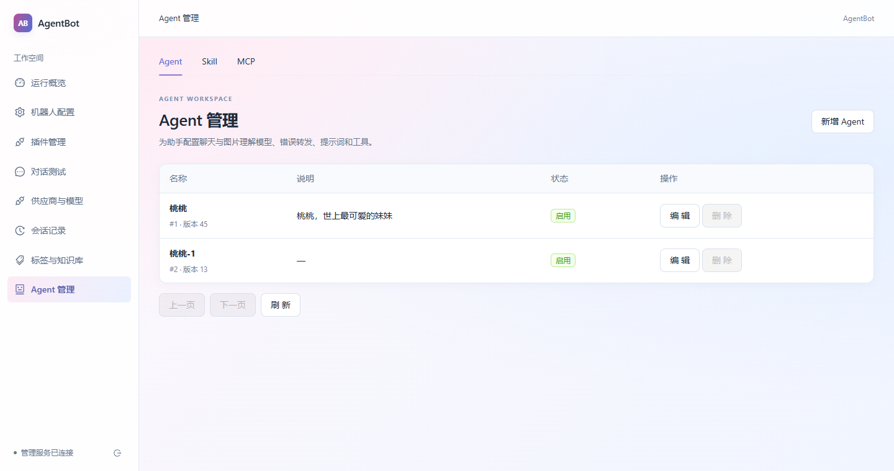
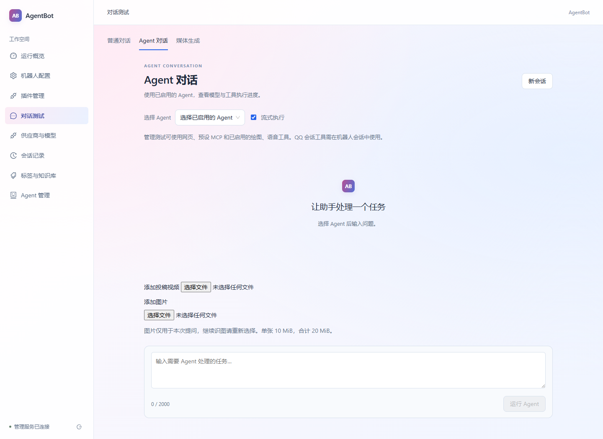
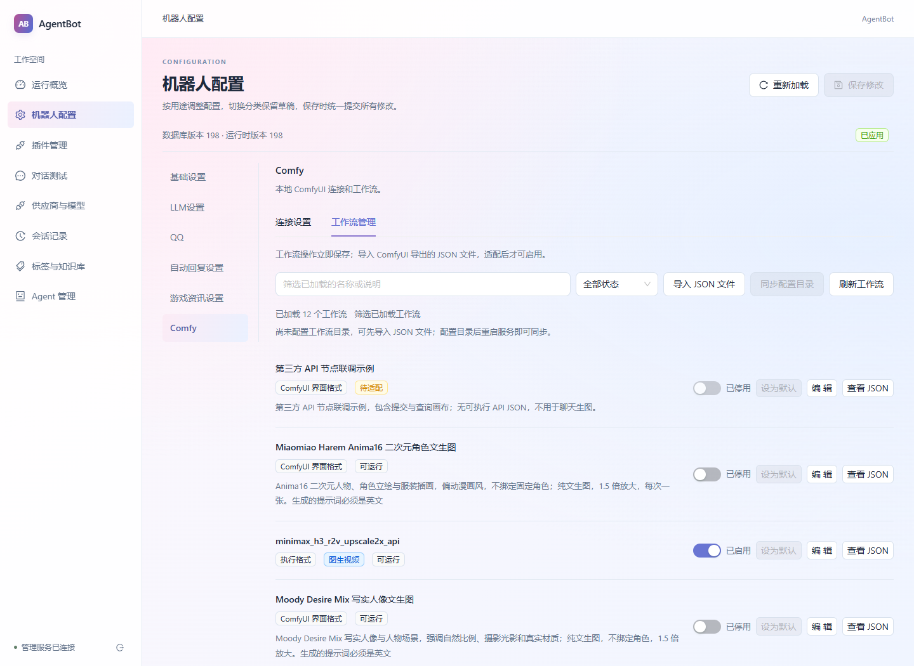
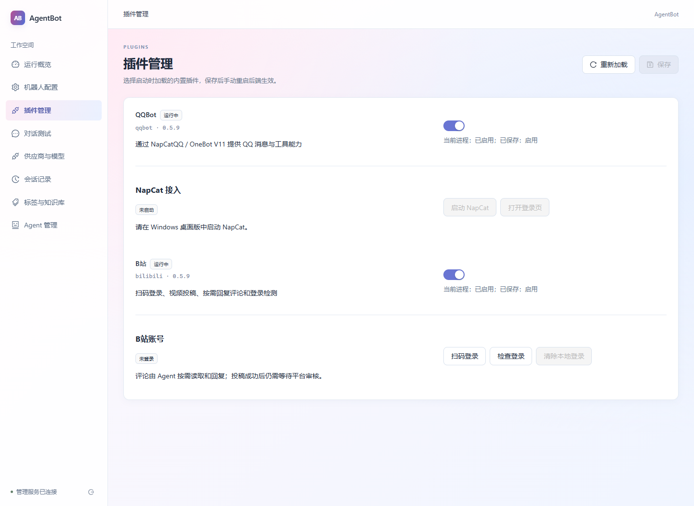

# agentBot

基于 Python、NoneBot 和 OneBot V11 的机器人服务，提供 React 浏览器管理界面。支持普通对话、多轮 Agent、Skill、MCP、图片理解、图片与对话音频生成，以及 ComfyUI 和 GPT-SoVITS 工具。

管理界面集中提供机器人配置、供应商和模型管理、Agent 配置、远程服务、对话测试及调用记录。默认使用 SQLite，MySQL、Redis 为可选后端；Windows 桌面版支持一键安装。

[Windows 一键安装](#windows-一键安装) · [源码安装](#源码安装与首次运行) · [媒体功能](#配置图片和音频) · [Windows 桌面版说明](WINDOWS_README.md)

## 界面预览

以下截图来自本地运行的管理界面，账号信息已隐藏。页面中的统计、预设和工作流为该实例的实际配置，不代表首次安装时的默认内容。

### 运行概览

集中查看对话数量、Token 用量、缓存命中率、服务就绪状态和机器人连接。



<details>
<summary>角色和人格：模型、提示词与工具授权</summary>

角色和人格在整页中编辑，上方按钮切换不同 Agent，新增也直接显示页内表单。下方左侧填写角色（职责、目标与规则），右侧填写性格（语气、性格与表达习惯），窄屏上下排列。两者组合为系统提示词，可预览实际组合内容；合计最多 32000 字符。现有提示词保留为角色，性格默认为空。切换 Agent 保留各自未保存的草稿。

各 Agent 独立配置模型、工具及远程服务授权，工具调用预算统一使用全局配置。MCP 管理移到一级“远程服务”页面；Skill 不再提供界面入口，历史绑定与执行行为保留。普通聊天、图片总结与系统通知读取同一份组合设定。



</details>

<details>
<summary>Agent 对话：独立测试与图片输入</summary>

选择已启用的 Agent，测试流式执行和图片输入；执行时可查看模型与工具进度。截图展示发送前的页面，测试消息不会发送到 QQ。



</details>

<details>
<summary>ComfyUI 工作流：导入、筛选与启停管理</summary>

在“插件管理 → Comfy 配置 → 工作流管理”导入 JSON、同步配置目录、筛选工作流并设置启用状态。



</details>

<details>
<summary>插件管理：QQBot 与 B站接入</summary>

统一查看内置插件状态并保存启动选择；Windows 桌面版提供 NapCat 启动及登录入口，B站插件运行后提供扫码登录入口。



</details>

## 内置插件

### 独立进程运行

每个内置插件均可通过独立命令启动为一个服务进程，提供自己的管理页面、端口和运行资源。
从项目根目录执行（安装包部署可直接使用 `agent-bot`）：

```powershell
uv run agent-bot plugin list
uv run agent-bot plugin run qqbot --workdir runtime/qqbot --port 8081
uv run agent-bot plugin run comfy --workdir runtime/comfy --port 8082
uv run agent-bot plugin run bilibili --workdir runtime/bilibili --port 8083
```

分别在终端运行上述命令，可同时启动多个进程。`--workdir` 必须明确指定，静态配置 `.env`、
默认 SQLite 数据库、QQ 队列和媒体目录均相对此目录解析；全新目录会按现有首次初始化规则生成独立配置和密钥。
已有目录保留原配置与数据，环境变量仍优先于启动文件；部署时为每个进程分别配置目录、端口与队列连接。
`--port` 只覆盖本次进程，不改 `.env`，网页将该覆盖字段设为只读；端口占用时启动失败，不自动换端口。

独立进程只加载命令指定的插件；该选择不写回既有数据库中的全局启停列表，也不会启停其他进程。
网页插件中心可查看目录和当前状态，启停开关只读；插件所属配置和工作流管理仍可正常保存。
QQBot、ComfyUI、B站进程各自拥有管理 API 及所需公共 Agent 服务，关闭其中一个不会退出其他进程。
Comfy 本地执行仍需在其配置页开启业务开关并满足原有模型与 Chat MCP 配置校验。

### 宿主统一加载

应用支持启动加载的内置插件，QQ 接入作为 `qqbot` 插件默认启用。“插件管理 → 插件中心”统一展示内置插件、安装与运行状态，并提供启停和配置入口；QQ、B站和 ComfyUI（`comfy`）都已随程序安装，停用不代表卸载。保存启停选择后，使用已有的“服务 → 重启后端”或手动重启服务生效。选择保存在所选运行配置数据库的 `app_enabled_plugins`，不通过环境变量覆盖。

插件成功启动后才开放所属工具并显示专属设置；未启用、准备中、启动失败或已停止时，只保留插件启用入口。停用插件不会删除 Agent 已保存的工具选择，重新启用并启动后恢复显示。

运行中的插件拥有独立二级配置入口：“QQ 配置”集中管理 NapCat 接入、QQ 账号与访问权限和游戏资讯；“B站配置”提供扫码登录与账号状态管理；“Comfy 配置”管理连接、执行开关与工作流。基础、LLM 和自动回复设置保留在“机器人配置”，自动回复分类不依赖 QQ 插件是否运行。离开独立配置页会取消账号状态读取、二维码轮询或工作流读取，运行设置草稿保留。

ComfyUI 新安装默认停用。升级时，原已启用本地工作流的部署由一次性迁移补入 `comfy`，保留其他插件选择；以后主动停用不会被再次开启。停用后保留连接配置、工作流和默认选择，关闭本地执行及工作流 HTTP 管理；模型直接生图和其他媒体能力仍可使用。升级顺序与数据影响见 [自动升级说明](sql/UPGRADE-AUTOMATIC.md)。

停用 QQBot 后，管理页面、AI 对话、Agent、会话和媒体功能继续运行；QQ 接入、消息队列、自动发言与 QQ 任务结果投递停止加载。公共 Python 任务执行仍可运行，待投递结果保留到重新启用 QQBot。插件列表为空时只启动公共服务。

新增内置插件需实现 `agent_bot.plugins.contracts.ApplicationPlugin`，提供元数据及 `prepare/start/stop/is_ready/bots`，并显式登记到 `plugins/catalog.py`。准备阶段不联网，异步启动分配资源，停止必须回收部分启动资源；插件不得关闭宿主提供的公共数据库池或媒体资源。本版本只支持内置注册，不支持第三方安装或热加载。

### B站插件

每次启动会按[自动升级说明](sql/UPGRADE-AUTOMATIC.md)检查所选数据库版本，自动执行适用的 MySQL / SQLite 增量；已完成历史迁移的既有库会自动补齐 B站表，新库完整初始化脚本已包含所需表。随后在“插件管理 → 插件中心”启用“B站”，保存并手动重启后端，在“插件管理 → B站配置”扫码、用手机客户端确认登录。账号 Cookie 只保存在当前选择的数据库中，不回填页面和模型。可检查登录、重新扫码或清除本地登录；清除不代表其他设备已退出。

在 Agent 的“允许工具”中按需选择 `bilibili_login_status`（实际检测登录）、`bilibili_get_my_videos`（我的已发布视频列表）、`bilibili_get_comments`（读取视频评论及楼中楼）、`bilibili_reply_comment`（回复指定评论）、`bilibili_publish_video`（视频投稿）、`bilibili_publish_dynamic`（发布图文动态）。视频列表读取当前登录账号，支持 `page`、`page_size`，每页最多 20 项，返回 BV/AV 标识、标题、发布时间和状态；不查询任意 UID，也不公开审核中或未发布稿件。评论仅由 Agent 按需调用，不运行自动监听任务。投稿、图文发布和回复仅限管理端或已有 QQ 超级用户，且仍需入口、会话和 Agent 工具授权。

QQ 对话会把当前插件已授予的 B站工具传入 Agent，不再被聊天路由的旧名单过滤。QQ 工具会话依赖 `chat_mcp_enabled`，需在“机器人配置 → 基础设置”启用 Chat MCP 工具服务并手动重启后端；B站插件也须处于运行状态。使用命名 Agent 时，仍须在该预设的“允许工具”中勾选所需 B站工具；启动插件不会自动扩大既有预设的权限。视频列表使用创作中心已发布稿件接口，协议结构参考 [biliup 的稿件列表实现](https://github.com/biliup/biliup/blob/master/crates/biliup/src/uploader/bilibili.rs)。

管理 Agent 对话通过统一的“添加文件”入口选择图片和不超过 100 MB 的 MP4，可同时提供视频和封面；视频选择仅在 B站插件运行时开放。请说明标题、简介、分区 ID、标签及原创/转载信息。视频只交给投稿工具，不作为图片输入；工具仅接受当前会话资产，不接受任意本地文件路径或下载 URL。转载必须提供来源。投稿返回“已提交审核”，不表示已公开。

图文动态工具 `bilibili_publish_dynamic` 接受 `text` 和按发布顺序排列的 `image_asset_ids`。正文最多 2000 字，图片 1–9 张，仅支持当前会话的 PNG/JPEG 资产，每张最多 10 MiB、合计最多 20 MiB；可引用本会话上传或工具生成的图片 ID，不接受远程 URL、本地路径或其他账号身份。所有图片授权和解码完成后才开始平台上传。

管理 HTTP 接口为 `POST /api/v1/bilibili/dynamics`，继承管理认证。先使用 `POST /api/v1/media/uploads?session_id=example-session` 上传图片，使用响应的 `id`（不是 `material_id`）作为图片资产 ID，再提交：

```json
{
  "session_id": "example-session",
  "request_id": "dynamic_001",
  "text": "今天的照片",
  "image_asset_ids": ["aaaaaaaaaaaaaaaaaaaaaaaaaaaaaaaa"]
}
```

`session_id` 必须与上传图片时一致；`request_id` 为一次发布的稳定请求号，重试时保持相同会话、请求号和参数。成功返回 `dynamic_id`、`url` 和 `status: submitted`，不承诺立即公开。上传与发布协议参考[图文动态接口说明](https://github.com/realysy/bili-apis/blob/master/docs/dynamic/publish.md)。

同一请求相同参数的成功写操作会返回已保存结果；最终发布响应丢失、无效或 HTTP 5xx 时保留待核对记录，不自动重发。结果未知时请先去 B站动态、投稿管理或评论区核对。平台额外验证、限流和权限错误会直接报告。本功能自动验证使用离线 HTTP / 数据库替身，真实扫码及账号发布需要在用户自己的账号验收。

### 表情包插件

在“插件管理 → 插件中心”启用“表情包”并手动重启后端，然后进入“表情包配置”。插件默认停用；普通QQ用户只能检索和发送已启用条目，图库上传、标签和元数据维护仅允许通过已认证的管理页面操作。

支持PNG、JPEG、WEBP、GIF，单张不超过10MiB，支持GIF、WEBP和PNG动画。类型以实际解码结果为准，不因文件后缀或浏览器声明错误拒绝合法图片。原件保留动画；识图仅使用独立生成的静态代表帧预览。可维护名称、自定义标签、画面含义、情绪、适用场景，并单独停用、删除或重新识图。自定义标签最多16个，每个1–32字符，识图不会覆盖管理员标签；修改和重新识图均校验条目修订，冲突后保留草稿并重新加载。

“表情包视觉与语境检索模型”可独立选择现有供应商目录中已启用的视觉模型。自定义Provider地址、协议和密钥仍在“供应商与模型”中保存，不读取环境变量，也不借用聊天模型。上传会先保存原件；已配置模型时自动识图，识图失败明确保留失败状态，管理员可重试。未配置模型时允许先上传并人工维护说明和标签。

机器人可按对话语气自主调用 `sticker_search` 检索，再调用 `sticker_send` 选择本轮推荐的一张表情包，无须用户明确说“发图”。语境匹配使用同一独立模型读取已保存的说明、情绪、场景和标签，不反复上传原图；图库较大时分批遍历并共用总超时。没有合适结果时不随机发图。使用命名Agent时须勾选这两项工具，QQ聊天MCP须启用；管理页也可试用语境检索。

QQ发送使用现有持久图片投递链，动图不会转换成静态图，也不会作为聊天模型的视觉输入。表情包原件和预览放在 `AGENT_BOT_MEDIA_DIRECTORY` 下的 `stickers/` 子目录，不随发布包分发。新库完整初始化及既有库自动迁移均包含 `stickers-v1`；升级沿用所选SQLite/MySQL，不重建已有库或覆盖密钥，详情见[自动升级说明](sql/UPGRADE-AUTOMATIC.md)。

## 机器人主人与配置工具

在“插件管理 → QQ 配置”中填写 `superusers`（机器人主人 QQ 号列表），格式如 `["123456789"]`，保存后手动重启后端。空列表不授权任何人。主人身份由真实 QQ 消息和服务端工具会话验证，聊天中的昵称、自称主人或模型参数不能授予权限。

普通聊天向主人提供 `bot_config_get`（配置查询）和 `bot_config_update`（配置修改）；使用命名 Agent 时，还需在该 Agent 的“允许工具”中勾选两项工具，并保持聊天 MCP 启用。可直接对机器人说“查询回复长度限制”或“把回复长度限制改为 1000”。普通用户及自动发言不会获得这两项工具，管理端对话也不能冒充 QQ 主人调用。

查询支持字段名、关键词和分页，密钥只显示是否已设置。修改仅提交本次编辑的非密钥字段，并校验数据库版本；启动配置还需校验启动文件版本。动态字段等待现有刷新机制生效，静态字段保存后须手动重启；由环境变量覆盖的字段只读。密钥继续在管理页面编辑，工具不执行重启。

## 本机目录与终端工具

在“角色和人格 → 允许工具”中显式勾选 `ls`、`bash` 后，管理端对话可列目录和执行命令；QQ 还须启用聊天工具，并且只有真实机器人主人可以使用。普通用户与自动任务不获得这两项权限，每次调用均重新验证会话与主人身份。不会自动给已有 Agent 增加授权。

`ls` 使用原生文件系统接口，返回文件名、类型、大小和修改时间，支持隐藏项和分页，不读取文件正文。`bash` 在 Windows 使用系统 PowerShell，在 Linux 使用 `/bin/bash`，工具说明及结果会标明实际终端。命令每次独立执行，可指定 `cwd`；相对路径默认从后端启动工作目录解析，不继承前一次 `cd`。

命令默认 30 秒、单次最多 120 秒，服从请求剩余期限和全局工具调用预算；两路输出合计最多保留 16000 字符，超出会标记截断。超时、取消和执行结束会清理 Windows Job 内的后代或 Linux 独立进程组。不支持主动脱离进程组并占用输出管道的后台命令，此情况明确返回错误，不会无限等待；不保证回收主动脱离进程组的 Linux 后代。命令以运行后端的系统账户权限执行，工作目录不是文件系统沙箱。Windows 依赖通过安装包或 `uv sync` 安装的 `pywin32`，不需要 Git Bash 或 WSL。

## 知识与记忆

“标签与知识库”提供知识条目及标签记忆的分页、关键词搜索、标签筛选、详情、新增和逻辑删除。两类记录均不能编辑；同作用域同记忆键（含已删除记录）不能覆盖或恢复，新增事实须使用新键。手工新增记忆可选择已有匿名作用域，或填写机器人及用户、群聊、会话目标；QQ 召回继续按原身份隔离。

知识条目是实例内共享资料，在 Agent 的“允许工具”中显式勾选 `knowledge_search` 后，可在 QQ 命名 Agent 和管理端对话中检索，并按 `【知识 #ID：标题】` 引用真实来源。首版支持手工文本录入及标签/关键词检索。既有部署先按 [SQL 使用说明](sql/README.md) 执行对应数据库的知识库增量，普通启动按已登记版本清单升级，不回放历史脚本。

## 模型调用

普通文本和 Agent 的模型调用统一通过 LangChain，显式支持 Chat Completions、Responses 和 Ollama 三种协议。Agent 由 LangGraph 编排模型调用、整批工具校验、顺序执行和收尾回答；业务工具通过 StructuredTool 接入，继续使用项目的 QQ 权限、MCP 会话、媒体作用域、总超时及取消机制。模型地址和凭据来自数据库快照，SDK 不自动重试或切换协议，外部 LangSmith tracing 在调用期间关闭。依赖由 `uv.lock` 固定，更新后重启服务加载新执行路径。

工具只能通过原生工具调用协议执行。模型把 DSML 的 `calls`、`invoke` 或 `parameter` 等控制标签写进正文时，响应校验会明确拒绝，QQ 投递前再次检查；不会从正文解析并执行配置修改，也不会删除标签后保留未经执行的成功声明。工具调用额度耗尽后的收尾回答必须说明尚未完成的操作。

当前使用纯 Python 服务，支持普通对话、Agent、媒体、一次性 Job 和自动发言决策；通用 Laya 指令和 SolonCode 暂未迁移。

## Windows 一键安装

维护者构建并发布到下载站：

```powershell
powershell -NoProfile -ExecutionPolicy Bypass -File tools/release_windows.ps1
```

脚本读取项目版本，完成测试、安装器与 SQL 包构建、上传校验及公网验证。
也可加 `-Version 0.5.11` 自动同步项目版本及固定版本断言；先准备 `sql/UPGRADE-0.5.11.md`。
参数与环境要求见 [发布说明](deploy/README.md#一键构建并发布)。

当前 Windows 发布版本：**0.5.11**。后续安装与更新以下载站的
[`latest.json`](https://public.loserbai.cn/agentbot/latest.json) 为准。

0.5.11 更新：Agent 管理改为内联编辑，新增独立人格、本机目录与终端工具，以及表情包图库插件。
从 0.5.10 更新前停服备份，启动时自动执行人格字段和表情包表增量；详见 [0.5.11 升级说明](sql/UPGRADE-0.5.11.md)。
[SQL 下载包](https://public.loserbai.cn/agentbot/AgentBot-0.5.11-sql.zip) 同时提供完整初始化与历史适用增量。

适用于 Windows 10/11 x64，无需安装 Python、uv 或 Node.js。

**PowerShell：**

```powershell
irm https://public.loserbai.cn/agentbot/install.ps1 | iex
```

**CMD：**

```cmd
curl -fsSL -o "%TEMP%\agentbot-install.bat" https://public.loserbai.cn/agentbot/install.bat && "%TEMP%\agentbot-install.bat"
```

脚本下载当前 Windows 安装器并校验 SHA256，默认安装到
`%LOCALAPPDATA%\Programs\AgentBot`，无需管理员权限。升级保留已有配置、数据库与媒体。

再次执行同一命令即可检查更新：未安装时安装；已有旧版时显示本机和服务器版本，
并在原安装目录升级；版本相同则提示已是最新版并跳过下载，本机版本更高时保留现有版本。
版本号使用 `主版本.次版本.修订号`，按数字比较，例如 `0.5.10` 高于 `0.5.9`。
本机版本读取安装器登记的信息，安装成功后由安装器更新；便携版需手动更新。

安装完成后，从桌面或开始菜单打开 `AgentBot`。首次启动自动生成配置和本地 SQLite 数据库，
进入管理页面后添加模型供应商和机器人接入地址。桌面运行需要 WebView2 Runtime；
运行要求、配置和排查方法见 [Windows 桌面版说明](WINDOWS_README.md)。

## 项目结构

```text
src/
  __main__.py       服务入口和离线命令分发
  application.py    NoneBot、管理 API 和静态界面装配
  admin/            管理 API、认证和流式对话
  ai/               模型供应商、普通对话和后端路由
  agent/            Agent、Skill、MCP 和工具执行
  media/            图片、音频、附件存储和媒体记录
  services/         聊天、记忆、工作流和任务队列等业务服务
  integrations/     OneBot、Redis、ComfyUI 和 GPT-SoVITS 集成
  plugin/           机器人事件处理和运行生命周期
  resources/        内置工作流资源
  static/           前端构建产物
web/src/            React/TypeScript 管理界面
tests/              后端测试、替身和夹具
sql/agent_bot_init.sql  完整数据库初始化脚本
tools/              开发安装映射和包检查工具
docs/               设计文档
```

Python 源码平铺在 `src/`，通过构建配置和开发安装钩子映射为 `agent_bot` 包。代码导入使用 `agent_bot.*`，NoneBot 插件路径为 `agent_bot.plugin`。请通过 `uv sync` 安装项目，再使用 `agent-bot` 或 `python -m agent_bot` 入口。

## 源码运行与构建环境

- Python 3.12 和 uv。
- 默认内置 SQLite 保存运行配置、记忆、业务记录和持久任务队列；MySQL、Redis 均为可选后端。
- Node.js 22，用于前端开发和源码构建；安装已构建的 wheel 后无需 Node.js。
- QQ 接入需要 NapCat，支持 OneBot V11 正向或反向 WebSocket。
- Windows 桌面版可托管固定版本 NapCat 并提供原生登录入口；已有部署保持外部接入。
  载荷准备、目录与使用方式见 [NapCat 桌面托管](WINDOWS_README.md#napcat-桌面托管)。
- 自动发言可选择 Laya 或 LLM 决策：Laya 需要登记提供 `laya_predict` 的 MCP 服务；LLM 使用独立配置的目录模型和决策提示词。
- 使用本地绘图或语音工具时，分别需要 ComfyUI 或 GPT-SoVITS。

## 源码安装与首次运行

以下命令均在仓库根目录执行。

### 1. 安装依赖并构建界面

```powershell
uv sync --extra dev --python 3.12
npm --prefix web ci
npm --prefix web run build
uv run agent-bot --help
```

前端构建产物写入 `src/static/`，由后端提供。不要手动编辑生成文件。

全新目录无需任何配置，直接执行 `uv run agent-bot`（桌面包双击 `AgentBot.exe`）。
程序自动生成 `.env`、两个独立随机密钥、SQLite 业务库、默认运行配置与本地持久队列；
OneBot Token 和会话密钥均写入 `.env`。
默认仅监听本机且免登录，进入管理页面后添加模型供应商和机器人接入地址即可。
已有配置会原样使用；若存在数据库却丢失配置，应恢复备份，不重新生成密钥。
以下步骤用于手动部署或既有环境迁移。

### 2. 配置静态启动参数

从 [.env.example](.env.example) 创建本地配置文件，已有文件不要覆盖：

```powershell
if (Test-Path .env) { throw ".env 已存在，请直接编辑已有文件" }
Copy-Item .env.example .env
```

未指定 `CHAT_DB_BACKEND` 时默认使用 SQLite，数据库保存到 `CHAT_DB_SQLITE_PATH=data/agent_bot.sqlite3`，不需要 MySQL 服务。使用 MySQL 时必须显式设置 `CHAT_DB_BACKEND=mysql`，填写 `CHAT_DB_HOST`、`CHAT_DB_PORT`、`CHAT_DB_USER`、`CHAT_DB_PASSWORD`、`CHAT_DB_NAME`，并先创建独立数据库及专用账户；旧 MySQL 部署升级前也需补上后端选择。连接失败不会切换数据库。SQLite 适合单实例部署。

队列默认 `CHAT_QUEUE_BACKEND=sqlite`，文件为 `CHAT_QUEUE_SQLITE_PATH=data/queue.sqlite3`，机器人运行不依赖 Redis。需要 Redis 时显式设置 `CHAT_QUEUE_BACKEND=redis` 并填写 `CHAT_REDIS_*` 后重启；原 Redis 部署升级也需显式选择。后端切换不迁移待处理任务，应先清空原队列。管理员密码沿用 `AGENT_BOT_ADMIN_TOKEN` 配置名，支持自定义 8–256 位字母、数字及常见符号，不含空格；含 `#` 等 dotenv 特殊字符时用引号包裹。留空或不配置时直接进入系统，所有管理接口均无需密码。已有随机令牌仍可作为登录密码。

OneBot Token 和会话密钥须分别使用至少 32 字符的不同随机值。手动部署时运行以下命令两次，分别填写 `.env` 中的静态 `ONEBOT_V11_ACCESS_TOKEN` 和 `CHAT_SESSION_SECRET`：

```powershell
uv run python -c "import secrets; print(secrets.token_urlsafe(48))"
```

| 配置分类 | 内容 | 存储与生效方式 |
| --- | --- | --- |
| 静态引导 | 数据库类型与连接、Redis、管理员凭据、媒体目录 | `.env`／环境变量；页面提供且允许编辑的字段可保存到启动文件，修改后手动重启 |
| 静态机器人与资源 | 驱动、监听地址、OneBot 签名密钥、会话密钥、命令匹配、MCP 挂载、目录、连接池、固定队列参数 | `.env`／环境变量；存在启动文件且无环境覆盖时可在页面保存，手动重启生效 |
| OneBot Token | `ONEBOT_V11_ACCESS_TOKEN` | `.env`／环境变量；存在启动文件且无环境覆盖时，QQ 分类可保存到启动文件，手动重启后端生效 |
| OneBot 接入地址 | 正向 WebSocket 地址、HTTP API 根地址 | 所选数据库，管理页面可修改，重启适配器连接后生效 |
| 运行行为 | 机器人名称、模型选择、提示词、访问名单、业务开关、生成参数、历史与记忆策略、任务及自动发言行为 | 所选数据库，管理页面或离线命令保存后热刷新 |
| 供应商／MCP 目录 | 每条记录独立的 URL、协议、密钥和工具权限 | 所选数据库，管理页面录入，新请求使用最新配置 |

静态参数中环境变量优先于 `.env`，管理员密码环境变量显式留空也会关闭登录校验；动态环境变量不会覆盖数据库。供应商和 MCP 地址及凭据不从环境变量读取。管理员密码、OneBot Token 和会话密钥职责不同，设置时使用不同的值。每个实例使用独立数据库、Redis 键前缀及媒体目录，不提交真实凭据或运行文件。

### 3. 显式初始化数据库

配置后执行：

```powershell
uv run agent-bot database init
```

命令按所选后端创建业务结构，覆盖配置、群成员、记忆、工作流、模型、Agent、Skill、MCP、媒体、Job 和记录。SQLite 会在首次自动配置或明确初始化时创建文件及父目录，并启用外键和 WAL；已有配置的启动只打开已有业务库。MySQL 需先创建数据库，初始化账户需要建表权限。

两种脚本分别为 [MySQL 初始化](sql/agent_bot_init.sql) 和 [SQLite 初始化](sql/agent_bot_init.sqlite.sql)。重复初始化保留数据，不插入配置或模型，也不修正已有不兼容结构。已有部署启动前按版本清单自动升级适用业务表，失败停止启动；本地队列库由独立的 [队列初始化脚本](sql/agent_bot_queue_init.sqlite.sql) 创建。

本地队列脚本也可作为既有 SQLite 库的独立增量执行；MySQL 结构基线对应
[队列表增量](sql/2026-10-13-local-queue.sql)。队列运行仍使用独立 SQLite 文件或显式 Redis，
不会迁移原 Redis 中的任务，也不会使用业务 MySQL 中的同名结构处理任务。

### 4. 初始化运行配置与迁移旧配置

新安装写入默认运行配置，再查看有效配置：

```powershell
uv run agent-bot settings init
uv run agent-bot settings list
```

默认访问策略不允许所有会话；启动后在“插件管理 → QQ 配置”设置允许的群和用户，再登记模型供应商及模型。初始化命令不读取动态环境值；若需要导入已有旧 `.env` 的业务参数，可用 `settings import-env` 代替 `settings init`。两者只允许首次初始化，重复执行拒绝覆盖。配置表只保存动态字段，静态字段始终保留在启动文件中。

已有混合配置表升级前先停止服务，使用现有数据库连接配置导出历史静态行：

```powershell
uv run agent-bot settings export-static .env.static-export
```

导出包含 OneBot Token、会话密钥等敏感值；终端只报告路径，目标文件必须不存在。备份当前 `.env` 后，把导出的静态字段合并到启动文件，保留数据库、Redis、管理员凭据和媒体目录；确认 `CHAT_DB_BACKEND=mysql` 后启动。不要在合并前运行配置保存：新版本读取时忽略历史静态行，下一次动态保存会清理这些行。导出文件合并后按部署权限管理，勿提交。

静态 OneBot Token 或会话密钥缺失、无效时启动明确失败，不会从数据库回填。已有 `.env`／环境变量中的 Token 继续作为启动配置使用；修改后重启服务。管理员密码可选，非空时须满足上述格式要求。运行配置缺失或数据库结构不匹配时按错误提示初始化或升级；SQLite 错误需检查文件路径、目录权限与结构，MySQL 错误需检查服务、账户与数据库。错误不回显配置值或驱动原文。

切换 `CHAT_DB_BACKEND` 只选择另一份独立数据库，不迁移业务数据；本次不提供 MySQL／SQLite 数据互迁。旧 MySQL 库从 `dispatch_chat_*` 改名后若缺少当前索引，执行 `sql/2026-10-13-chat-index-names.sql` 原位升级，保留历史记录。

### 5. 启动服务并连接 QQ

```powershell
uv run agent-bot
```

也可使用 `uv run python -m agent_bot`。该入口同时启动机器人、管理 API 和浏览器界面。

默认管理地址为 [http://127.0.0.1:8080/](http://127.0.0.1:8080/)，设置管理员密码时输入密码登录，密码留空时直接进入工作台。密码只保留在本次页面内存，退出或刷新后重新判断登录模式。实际监听地址由静态启动配置 `HOST`、`PORT` 决定。

使用正向 WebSocket 时，在管理页面的“插件管理 → QQ 配置”中保存 `onebot_v11_ws_urls`，例如 `["ws://10.0.8.6:3001/"]`；启动时从数据库读取，旧 `.env` 中的空地址不会覆盖数据库。`onebot_v11_api_roots` 同样保存在数据库。地址修改后需重启适配器连接，页面会显示重启提示。静态 `DRIVER` 使用 `~fastapi+~websockets`（新默认值），NapCat Access Token 与 `.env`／环境变量中的 `ONEBOT_V11_ACCESS_TOKEN` 一致。

OneBot Token 在网页“插件管理 → QQ 配置”中不回显；存在启动文件且未被环境变量覆盖时，可填写新 Token 并与其他运行草稿一起保存。管理 API 允许保存页面提供且严格授权的静态启动字段，值仍保存在 `.env`／启动文件中，不写入运行配置数据库；未编辑的字段和密钥保留。保存使用启动文件版本防止覆盖外部修改；静态密钥留空保留原值，可空密钥需明确点击“清除此密钥”才会清除。静态修改保存后保持当前连接与数据库后端，页面提示需要重启；手动使用已有桌面“服务 → 重启后端”应用新配置，并同步更新 NapCat Access Token。“插件管理 → QQ 配置”可启动本窗口所属 NapCat 并打开登录页；不提供其他进程控制。环境变量覆盖或缺少启动文件时相应字段只读；写入权限不足会明确报错，需修正实际启动环境或文件权限后再保存。

`CHAT_SESSION_SECRET` 用于生成会话 ID 与标签记忆身份摘要。修改并重启后会使用新的会话与身份命名空间；旧历史和记忆数据保留，但不再匹配原会话身份。供应商和 MCP 密钥不受影响。修改数据库类型或连接也只会在重启后选择新后端，不迁移已有数据。

使用反向 WebSocket 时，在 NapCat 配置地址 `ws://127.0.0.1:8080/onebot/v11/ws`，跨机器连接时改用 agentBot 所在主机地址。不要同时运行两个连接同一机器人和队列前缀的实例。

## 管理界面与运行配置

工作台提供运行概览、机器人配置、对话测试、供应商与模型、会话记录、角色和人格、Skill 管理和 MCP 服务。“供应商与模型”左侧选择供应商，右侧显示其模型及启用开关；保存供应商后自动获取并保存全部模型，无需二次导入。供应商、Agent、Skill、MCP 的新增与编辑在弹窗中填写；取消丢弃草稿，保存失败保留输入并提示错误，保存成功关闭弹窗并刷新列表。机器人配置在页面内部使用左侧导航，分为“基础设置”、“LLM设置”、“记忆设置”和“自动回复设置”；“记忆设置”与 LLM 同级，集中管理会话心智记忆、标签记忆、历史保留、自动压缩和向量模型；“Comfy”在插件配置页管理；“QQ”和“游戏资讯设置”移至“插件管理 → QQ 配置”；移动端分类入口置顶并分行显示。切换分类保留草稿，保存统一提交所有分类的可写修改，搜索只筛选当前分类。静态字段按用途归类、标注重启生效；存在启动文件且未被环境变量覆盖时可在页面保存，之后手动重启后端。动态字段仍写入数据库并热刷新。关闭浏览器不会停止服务。

“QQ”集中管理 OneBot 接入、机器人名称和访问权限；“自动回复设置”管理关键词回复、回复长度与冷却、群聊上下文、主动发言和定时任务；永劫无间的账号凭据、服务器和查询限制统一放在“游戏资讯设置”。分类只改变展示，仍沿用同一数据库版本、草稿和保存操作。

“自动回复设置”可启用 `chat_multi_reply_enabled`，让 Agent 在 QQ 普通对话、工具调用后的最终回复及主动发言中按语义发送多条消息。默认关闭；`chat_multi_reply_max_messages` 默认 3 条（1–10），`chat_multi_reply_interval_seconds` 默认 1 秒（0–10）。`chat_multi_reply_prompt` 可调整分条风格，程序自动追加严格 JSON 字符串数组协议，例如 `["第一条消息", "第二条消息"]`，单条也使用数组；模型格式错误、空消息或超条数会明确失败，不将原始 JSON 发到 QQ。关闭时若模型仍返回完整的 JSON 字符串数组，则直接拼接全部元素为普通正文，不发送数组包装且不受多条条数限制；普通文本保持原样。开启时数组元素就是消息边界，不再按 `chat_chunk_chars` 切分；普通聊天超出正文总长度仍发送完整文本文件，主动发言按专用长度限制裁剪已解析正文。仅首条附加原生 @，失败重试沿用已确认发送进度；媒体结果、决策报告和管理端调试不受此开关影响。四项设置均通过现有配置数据库保存并热更新，不需要修改数据库表结构或执行迁移 SQL。

模型统一在本地目录登记，QQ 功能按各自开关启用。无需设置普通文本、Agent 或媒体的后端选择字段。模型或工具调用失败会返回对应错误，未迁移能力会在路由预检时拒绝。

旧外部 AI 地址、令牌和后端选择配置已删除。已有数据库快照中的旧字段在读取时忽略，下次保存配置时清理；升级代码后需重启服务。历史 SQL 仅用于归档，新库不再创建旧模型兼容目录。

会话记录分为“调用记录”、“系统调用”和“媒体运行记录”。系统调用集中显示自动发言决策及机器人显式指令（如总结、查询）触发的模型调用，支持按“自动发言决策”或“指令调用”筛选；普通调用页排除这些记录。所有详情在弹窗内查看。Laya 决策只归档脱敏结果，不保存群聊状态正文；LLM 决策沿用普通调用归档，可在系统调用详情查看本次提示词、群聊输入、输出及实际模型用量，决策记录不进入聊天历史。

已有独立决策记录可手动执行 `uv run agent-bot records migrate` 回填到统一记录表（需已安装当前数据库结构）。命令按来源去重，重复执行不覆盖已有记录；普通启动不会自动回填。历史指令仅在已有请求标识或指令输入能明确识别时归入系统调用。

统一调用记录的 `create_time` 使用北京时间（UTC+8），与旧系统历史记录保持一致；普通调用的原始 UTC 微秒保存在同表 `created_at_utc`，Agent 执行及自动发言决策表的 `created_at` 继续使用 UTC。`uv run agent-bot records repair-times` 按仍存在的源表校正统一归档时间，不会猜测已退出来源的时间或重复加八小时。校正后刷新记录并回到第一页，原分页游标应丢弃。

普通调用已停止双写 `agent_bot_ai_session`，旧普通列表和详情接口直接读取统一归档，并保留原 UTC 微秒、完整长正文、用量和失败代码。已有部署先备份，执行一次 `sql/2026-10-20-merge-ai-sessions.sql`（MySQL）或对应 `.sqlite.sql`，再运行 `uv run --no-sync agent-bot records merge-ai-sessions`。合并按原来源及执行 ID 去重，补录缺失记录；已有记录逐字段校验后只补原始 UTC 时间，不改 ID、请求快照和指令分类；冲突明确失败，重跑不重复写入。所有旧后台停用并完成新版启动、全字段及备份校验后，显式执行 `sql/2026-10-20-retire-ai-session.sql` 或对应 SQLite 脚本删除旧普通表。普通启动不回放这些历史转换或执行旧表清理，新库初始化不再创建旧普通表，其结构归档在 `sql/legacy/ai-session-v1.*`。

## 配置模型与对话

1. 在“供应商与模型”点击“新增供应商”，在弹窗中填写名称、协议、API 根地址和 API 密钥，保存到所选数据库。支持 `openai-responses`、`openai-chat` 和 `ollama`，无需鉴权的本地服务可留空密钥。可以新增多个供应商，每个供应商有自己的 URL 和 Key。
2. API 根地址不包含 `/responses`、`/chat/completions` 或 `/api/chat`。保存后自动获取并保存该供应商的全部上游模型，也可点击“刷新模型”再次同步。兼容协议读取 `/models`，Ollama 读取 `/api/tags`；服务未实现列表接口时明确提示错误。同步失败保留供应商和已完成批次，点击“刷新模型”可继续，无需重复新增供应商。
3. 新模型默认停用，在右侧列表切换“是否启用”。模型以“供应商 + 上游模型 ID”唯一定位，无需设置别名；不同供应商可以提供同名模型。重复同步跳过同一供应商下已登记的模型，保留启用状态和媒体配置；不删除上游已下架的本地模型，可自行停用。
4. 在“机器人配置 → LLM设置”选择“供应商 / 模型”。保存的是稳定模型引用，供应商改名不改变选择；Agent原有记录ID绑定保持不变。在“对话测试”验证同步或流式回复；临时模型选择只影响本次请求。既有部署先按 `sql/UPGRADE-MODEL-IDENTITY.md` 迁移旧模型配置。
5. 编辑已有供应商时，密钥不会回填；留空保留，填写新值替换，明确勾选清除才移除。保存后下一次请求生效，无需重启，已开始执行的请求继续使用原快照。

QQ 对话入队前检查实际使用的模型；模型未登记或未启用时直接返回固定配置错误，不调用模型、不创建任务。已排队请求遇到模型失效时也会报错并清理任务，不进入死信；上游请求拒绝、协议错误等执行故障仍按原队列策略处理。

QQ 日常聊天统一进入 Agent，包括关闭联网搜索、未授权工具的情况；无工具时由 Agent 直接生成回答。普通文本模型仅用于总结等现有专用指令和内部辅助生成，`/chat`、`/聊天` 仍不开放。管理页面的普通对话测试入口保留。

QQ Agent 执行超时或工具会话过期时，已有非空正文会直接投递，执行记录仍标记失败并保留原错误码；没有可投递正文时，工具或执行失败的说明也使用当前 Agent 预设及其备用模型，归档为 Agent 调用；说明隔离历史并关闭本地、知识和 MCP 工具，避免重放原任务。备用再次失败时结束，不降级为普通模型调用。解释仍失败或返回空白时不回复，不发送固定失败文案；启用 `mention_member` 不影响已生成说明的投递。模型连接故障、HTTP 408、429 和 5xx 在同一模型请求内最多重试三次（首次调用加三次重试），共用原超时预算；队列不叠加重试已耗尽预算的同类模型故障。参数与鉴权拒绝、已经开始返回内容的响应不重放。已有正文的模型超时不会转交备用模型。普通聊天回复超过 `chat_max_reply_chars` 时，将完整正文作为 UTF-8 `.txt` 文件发送到原群聊或私聊，不截断；文件投递选择与正文一起持久化，上传重试不会重新调用模型。文件使用 NapCat 的上传接口传输，无需共享本地目录。自动发言仍遵循专用长度限制。

机器人配置中的系统提示词 `chat_system_prompt` 允许留空；保存空值后不会恢复默认提示词，调用时省略这条系统消息。Agent 自身配置的提示词和必要的工具规则仍然生效。

QQ 当前上下文统一保存在 `chat_session_context`，每个 `session_id` 一行，不设置过期时间或按会话数自动淘汰。接收消息先登记，只有平台确认发送的回复、通知及素材引用进入助手消息；同一 session 的并发追加在短事务中合并，按消息 UTC 时间及稳定序号排序，不因普通消息版本竞争拒绝更新。超过近期窗口后按配置压缩或裁切旧消息，显式重置才清空当前上下文并切换代际。旧 `chat_history_ttl_seconds` 配置不再展示或生效。

已有部署先停止服务并备份，执行 `sql/2026-10-19-session-context.sql`（MySQL）或 `sql/2026-10-19-session-context.sqlite.sql`（SQLite），再运行 `uv run python tools/migrate_session_context.py --dry-run` 核对来源数量，去掉 `--dry-run` 导入后手动重启。迁移读取旧会话、轮次及存在的出站表，保留摘要、实际分段和待确认发送身份；已有新上下文不会被覆盖，旧表和旧数据不会被删除。缺少旧 `chat_sent_message` 的部署也可直接迁移，无需先补建旧表。新库仅执行当前统一初始化脚本，不再创建旧 `chat_memory_session`、`chat_memory_turn`、`chat_memory_receipt` 或 `chat_sent_message`；其结构归档在 `sql/legacy/session-context-v1.*`。队列入队回执仍独立负责防止任务重复入队，长期标签记忆及群背景保持独立权限和检索行为。

确认所有实例已停用旧代码、当前上下文和请求及投递身份均已迁入新表，且旧原文已由调用记录或完整备份保留后，可显式执行 `sql/2026-10-20-retire-legacy-session-context.sql`（MySQL）或对应 `.sqlite.sql`，永久删除上述四张旧会话表。清理前备份旧表与新表；脚本只检查新表存在，不代替迁移、覆盖校验和备份。旧服务仍在运行时禁止清理。长期记忆、调用记录和队列回执不在此次删除范围内。

长期标签记忆统一保存在 `chat_tagged_memory`，每条事实保留原 ID、匿名 `scope_id`、稳定键、原文、删除墓碑和时间；`scope`、`tags_json`、`material_ids_json` 内嵌授权类型、标签与素材 ID，取代 `chat_memory_scope`、`chat_memory_tag`、`chat_memory_material`。同范围写入先取得事务外命名锁，提交或回滚后释放；SQLite 用短写事务串行合并。用户、群和机器人权限及素材原件的会话校验保持有效。

已有部署停止旧服务并完整备份后，执行 `uv run --no-sync python tools/migrate_tagged_memory.py`，再加 `--verify-only` 逐字段核对。工具自行完成 MySQL 增量或 SQLite 受控事务重建，保留 ID、自增序列、原文、墓碑、时间及全部关联；已有空作用域、孤儿或不一致时明确失败，保留来源供处理。确认代码已切换且完整备份可用后，可执行工具的 `--retire-legacy` 或对应 `sql/2026-10-20-retire-legacy-tagged-memory.*` 清理三张旧关联表。迁移和退役均须在无并发业务写入的维护窗口执行；新库仅运行统一初始化即可获得单表结构。

既有库先执行 `sql/2026-10-13-dynamic-provider-mcp-credentials.sql`，只增加字段并保留旧表和数据。旧环境变量引用需要在页面重新录入密钥；不会自动导入 `.env`。新库直接使用统一初始化脚本。

模型服务需支持所选协议和生成参数。不支持的参数会明确报错，不会更换参数后重试。记忆压缩请求固定关闭深度思考；当前 Ollama 可表达该选项，其他协议不支持时会拒绝压缩并保留已有记忆。

会话记录包含调用正文、回复和元数据。记录写入失败时仍返回已经获得的模型结果，并提示未保存；无需重发。取消的轮次保留部分回复和取消状态，不加入成功历史。

## 配置 Python Agent 和工具

1. 完成供应商和模型登记，选择支持原生工具调用的模型。
2. 按需在“远程服务”登记 Streamable HTTP 或 SSE 地址、工具白名单和访问令牌，再在 Agent 中关联服务。QQ 命名 Agent 与管理端均直接使用该 Agent 已绑定的远程服务，不再要求在全局列表重复授权；未指定 Agent 时才使用“LLM设置”的全局远程服务列表。搜索 MCP 与其他 MCP 使用同一规则，直接暴露服务端原生工具名称和参数，不再通过内置 `web_search` 包装或全局搜索绑定。分类仅用于管理展示，不需要指定特殊搜索工具字段。内置搜索及 `chat_python_search_mcp_code` 已删除，旧 Agent 中的内置搜索授权会在读取和保存时清理；旧设置行在下次正常保存配置时移除。`read_url` 仍用于读取公网网页，历史开关 `chat_web_search_enabled` 仅控制此本地读取工具，不影响独立 MCP 搜索。
3. 按需创建 Skill，再创建 Agent，选择模型、内置工具和 Skill。Agent 可关联最多 3 个通用 MCP 服务，连接后自动向模型提供服务白名单内的工具，无需在 Agent 中逐个勾选；MCP 白名单为 `*` 时提供服务返回的全部工具。白名单筛选后所有服务合计最多 32 个 MCP 工具，超限时明确报错；Skill 所需的内置工具也必须在 Agent 中授权。工具调用次数统一在“机器人配置 → LLM设置”调整，默认 5 次，可填写任意正整数或清空为不限次数；不再受单轮 8 次、整次 40 次、最多 5 轮等固定调用预算限制，请求超时与权限校验仍生效。批量调用按每个工具请求计数，参数校验失败也占用预算；超出预算的项返回未执行结果，并进入最终回答。
4. 打开“对话测试 → Agent 对话”默认选中第一个已启用 Agent，也可手动切换；执行步骤和结果可在“会话记录 → Agent 运行记录”查看。
5. 在“机器人配置 → LLM设置”通过下拉框选择聊天、图片理解、图片生成和语音模型，只展示已启用模型，多个用途可以重复选择同一模型。此处还可设置默认 Agent 预设代码 `chat_python_agent_code`、工具调用次数 `chat_agent_max_steps`、未指定 Agent 时使用的远程服务 `chat_mcp_services`、网页读取和群成员 @ 工具授权。角色和人格页只维护预设，运行字段集中在机器人配置；保存沿用配置版本校验和热刷新，分类切换保留草稿。预设代码留空时仍走 Agent，使用当前 Chat 模型、提示词和预算。旧预设字段 `max_steps` 和旧联网字段 `chat_web_search_max_steps` 保留兼容读取但不再决定执行预算，QQ 和管理页聊天均服从统一设置；旧设置中的正整数现在按调用次数计数，已保存的 null 表示不限次数。旧 `chat_agent_enabled` 开关已移除，数据库中的历史值不再生效，下次保存配置时清理；不需要 SQL 结构迁移。每个 MCP 服务独立保存地址与令牌，编辑令牌留空保留、明确清除才删除，保存后新请求立即使用新配置。

在 MCP 服务编辑页点击“获取全部工具”，可读取已保存连接的完整工具列表并逐项启用、关闭，也可启用全部或关闭全部。开关修改在“保存 MCP”后更新工具白名单，空集合表示关闭全部工具，执行时不再连接该服务；获取列表本身不会执行工具或修改配置。搜索类服务同样可以逐项关闭全部工具。新增服务或修改连接地址、协议、令牌后，先保存再获取列表。

Windows MCP 等服务返回的截图会经过真实图片校验，并作为私有图像观察传入后续 LangChain 模型轮次；图片字节不写入工具步骤或日志。工具首次返回图片时使用 Agent 已配置的图片理解模型；未配置时要求当前模型具备识图能力，不会自行选择其他模型。响应传输预算包含图片的 base64 编码，单图、总图片量和模型上下文仍沿用现有媒体限制。

“角色和人格 → 编辑 → 模型路由”分别配置聊天模型、图片理解模型和错误转发模型，三个角色可以选择同一个模型。纯文本走聊天模型；QQ 当前消息或引用消息携图、管理对话上传图片时走图片理解模型。带图请求必须配置图片理解模型，所选模型还须在供应商页面显式启用图片理解能力；未配置或能力不符时明确报错。Agent 路由优先于机器人全局模型配置；不按模型名称推断能力。

错误转发默认关闭，选择备用模型后才开启。主模型配置或上游调用失败时，备用每请求最多接管一次，只继续失败的模型轮次，保留已完成的工具结果，不重复执行工作流。备用与本次实际使用的模型相同时跳过转发，避免向同一个模型自我兜底。带图请求的备用也需支持图片理解；跨模型接管移除旧供应商私有延续，不丢弃输入图片。权限拒绝、工具执行错误、取消和请求总超时不会触发转发；备用仍失败时返回实际错误。执行记录的 warning 步骤保存原错误码及转交模型，后续请求重新从主路由开始。

既有数据库升级此功能需在新版本启动前执行一次 `sql/2026-10-13-agent-model-routing.sql`（MySQL）或 `sql/2026-10-13-agent-model-routing.sqlite.sql`（SQLite）。脚本仅新增两个可空模型引用，原聊天模型绑定和数据保留；新库直接执行对应 `agent_bot_init` 初始化脚本。普通启动仅自动执行已登记且适用的版本增量；本段所列历史转换仍先核对原版本起点。升级并由运维重启一次后，在管理页修改这些模型路由对新请求即时生效。

QQ 工具包括标签记忆、永劫无间查询、群成员提及、本地工作流和 TTS；内置网页工具仅保留 `read_url`。网页搜索使用单独关联并授权的 MCP 服务及其原生工具。QQ 本地工具链需要启用 `chat_mcp_enabled`，通过会话短期令牌校验权限。

QQ 文字回复在分段和投递前统一清理空白行：连续换行以及只包含空格或制表符的空行合并为单个换行；保留正常换行和正文缩进。普通对话、工具回复、命令回复和已生成的定时任务正文均遵循此规则。

历史中的 `[AT QQ号]` 是原生 @ 的内部记录格式，不是可直接发送的正文。提示词禁止模型照抄，回复出口也统一清除这种标记；普通 QQ 号保持原样，标记不会被转换为平台 @。真实提醒仍通过已授权的 `mention_member` 或已有网关前缀投递，实际发送记录继续保留原生 @ 的身份信息。

在“插件管理 → QQ 配置 → 机器人名称与触发别名”中每行填写一个名称或别名，例如“桃桃”和“小桃”。群聊消息包含任一名称即可触发，英文名称忽略大小写；名称配置保存到数据库并热更新，同时刷新 OneBot 名称识别。清空后保留 At、回复机器人消息及命令触发。旧 `.env` 的 `NICKNAME` 不再作为启动名称来源；升级时如有仅保存在环境文件的名称，请在管理页面重新保存。加载本次代码变更需要由用户重启服务，之后修改名称无需重启。

`read_url` 遇到 HTTP 拒绝或网络不可用时，向模型返回明确的失败工具结果，由模型根据已有资料说明限制，不因此重跑整段对话。公开地址校验失败、请求取消和总预算耗尽仍会终止执行。网页失败日志只记录目标主机及 HTTP 状态或异常类型，不记录链接查询参数和响应正文。

管理 Agent 可使用网页、授权的 MCP 和已启用的 `local_workflow_list`、`local_workflow_generate_image`、`tts_generate`；管理入口不接受客户端提供的 QQ 令牌、用户或群身份。

Job 默认关闭，启用后作为 QQ 专属工具执行。管理 Agent 不接受 QQ Job 工具；SolonCode 和通用 Laya 指令尚未迁移。自动发言由独立 Python 服务接入，支持 Laya / LLM 二选一决策。

停止请求、切换模式、离开对话页或退出登录会取消当前管理请求。已经完成的工具操作不会撤销；结果无法确认时记录为 `unknown`。残留的 `running` 记录不一定表示任务仍在执行。

“调用记录 → 查看详情”直接展示原生 Agent 每次工具调用的入参和返回值，按调用 ID 配对，保留调用轮次、状态、耗时和附件元数据。“Agent 执行详情”同样提供此视图。入参和返回值保存前递归清除凭据，JSON 工具正文格式化展示；媒体二进制及模型私有延续不进入步骤记录。工具取消或异常而没有返回时保留入参、稳定错误码与结果未知状态，不自动重执行。历史未保存的负载显示“未保存入参／未记录返回值”，无法补回。

既有库需在新版本启动前执行一次 `sql/2026-10-13-tool-call-payloads.sql`（MySQL）或 `sql/2026-10-13-tool-call-payloads.sqlite.sql`（SQLite）。增量只添加工具步骤的可空 JSON 字段，不改写历史记录；新库初始化脚本已包含完整结构。此变更加载后，新工具调用即开始保存负载，服务启动时会按版本清单自动升级适用数据库结构。

## 配置图片和音频

1. 在“供应商与模型”左侧选择供应商，右侧模型列表直接开启“图片理解”，开关会立即保存；同时启用所选模型和供应商。回到 角色和人格点击“刷新模型状态”，即可将该模型选作图片理解模型。识图能力须由供应商实际提供，开关只声明能力。直接生图的接口类型在同一列表的“图片生成协议”选择 `gpt-image` 或 `legacy-b64`，切换协议保留图片理解及对话音频配置。对话音频能力仍由媒体配置接口保存。Ollama 支持图片理解，不提供这里的直接图片/音频生成；`legacy-b64` 输出仅支持 PNG。
2. 按需启用图片理解、图片生成或 TTS 对应功能开关，媒体调用统一由 Python 处理。
3. 根据部署位置设置 `AGENT_BOT_MEDIA_DIRECTORY`，默认 `data/media`。目录应由本实例独占且可读写，不使用符号链接或重解析点。修改启动目录后重启服务，再查看概览中的媒体就绪状态。
4. 在“对话测试 → 媒体生成”生成图片或对话音频；在“Agent 对话”上传图片，也可仅提交图片。

在 QQ 或管理端 Agent 对话中直接生图，需要在“LLM设置”开启 `chat_image_generation_enabled`，为 `chat_image_model` 选择已启用生图协议的供应商与模型，并在当前 Agent 的允许工具中勾选“模型直接生图”（`image_generate`）；QQ 同时需要开启聊天工具（`chat_mcp_enabled`）。此工具仅支持文生图，不依赖 Comfy。QQ 先发送模型选定的开画文案，再提交已有后台绘图队列，重试复用持久回执；管理端同步返回属于当前 Agent 执行的图片附件。直接生图与 Comfy 工作流共享每次请求一张图片的额度，输入图片编辑仍使用相应工作流。

QQ 实际发送的消息和生成文件会保存到对应会话上下文，媒体原件关联素材 ID。Agent 启用 `material_search`、`material_get` 后，可查询并读取上一轮素材；图片作为独立消息发送，主动发言同样支持。历史图片读取保持聊天模型路由。已有部署需要手动新增出站消息表，详见[升级说明](docs/migration/2026-10-19-outgoing-context.md)。

开启聊天工具（`chat_mcp_enabled`）后，`superusers` 中的机器人主人通过真实 QQ 消息可跨 QQ 会话检索和读取素材，支持在另一个群直接提供已有素材 ID。每次工具调用重新验证当前会话令牌；普通成员和自动回复仍限当前会话，QQ 主人权限不包含管理端上传或生成的素材。原素材归属、标签和记忆写入权限保持原有规则，无需迁移数据库。

持久素材库不设置总容量配额，也不按临时附件的过期时间清理。QQ 绘图成功入队后即结束当前 Agent，后台独立生成并投递图片，无需等待或轮询进度。

管理端“标签与知识库 → 素材库”可按关键词、文件类型、素材分类、标签、来源和会话筛选，支持页码、总条数、跳页及每页 20／50／100 条。图片列表按可见区域加载经认证的缩略图，打开详情后读取原件；普通文件提供文件标识和下载。

图片仅在触发对话接收、LLM 发送或生成时保存，不收集未触发的普通 QQ 图片消息。直接模型生成、Agent 与 Comfy 工作流生成的图片均保存持久原件，管理端尚未发送的生成结果也可在素材库查看。同一会话内相同内容复用原件，可同时归类为“触发接收”“LLM 发送”“生成图片”“手动上传”。接收、生成和手动上传首次入库时自动附带来源标签，管理员可编辑或清空标签（最多8个，每个1–32字符）；后续流转只补充已确认分类，保留手动标签。历史素材继续保留，不猜测来源，显示为“未分类”，再次真实触发时补充本次分类。更新安装后的首次启动按登记的 `material-classification-v1` 自动新增分类及标签关联表，详见[自动升级说明](sql/UPGRADE-AUTOMATIC.md)。

ComfyUI 工作流需要先在插件中心启用 ComfyUI 并重启，再配置 `chat_local_workflow_*` 并启用本地工作流执行；执行开关关闭时仍能管理工作流。GPT-SoVITS 需要配置 `chat_tts_*` 并启用 TTS。Agent 还需授权对应工具。

在“插件管理 → Comfy 配置”中，“连接设置”管理服务地址和生成参数，“工作流管理”提供列表筛选、JSON 文件导入、目录同步、启用/停用、默认工作流选择，以及名称、说明和附加提示词编辑。工作流操作单独保存；默认选择保存后会更新配置页版本并保留其他设置草稿。列表每次加载 100 条，可继续“加载更多”；筛选作用于已加载的记录。

导入支持现有转换器识别的 ComfyUI 界面 JSON 和 API JSON，单文件不超过 1 MiB；不可执行的画布保留用于查看，不能启用。复杂图生图或固定参考工作流沿用目录中的 UI/API 配对及 `.meta.json` 节点绑定。详情可查看和导出原始界面或执行 JSON，不在网页编辑技术节点。

“同步配置目录”读取机器人服务所在机器当前生效的 `CHAT_LOCAL_WORKFLOW_DIRECTORY`，不会自动从远程 ComfyUI 拉取工作流。修改该启动目录后需要重启服务；未配置目录时仍可直接导入 JSON。同步新增记录或更新已有技术内容，保留管理员维护的名称、说明、附加提示词和启用状态，也不会删除目录中已移除文件对应的数据库记录。工作流存入当前选定的 MySQL 或 SQLite，后续绘图任务读取最新记录。

H3 图生视频可导入 [`minimax_h3_r2v_ultrasharp720p_api.json`](src/resources/minimax_h3_r2v_ultrasharp720p_api.json)，或同步受支持的平铺 H3 画布。导入后明确启用，并在目标 Agent 中授权 `local_workflow_list` 和 `local_workflow_generate_video`；不会自动给已有 Agent 添加权限，也不能把视频设为默认生图工作流。当前模板按时序一致性优先：原始帧可选降噪、相邻三帧 RAFT 融合、保守超分、可选轻锐化，输出 720×1280、8 秒音视频；降噪和额外锐化默认关闭，模型增强只混入 35%。ComfyUI 需安装配套 `h3_frame_upscale.py`、`h3_temporal_consistency.py` 及本地模型。历史 1080p 和两倍模板仍保留。视频保存在媒体目录，QQ 后台任务和发送重试只持有附件引用；管理端支持认证播放和下载。视频上限为 100 MiB，图片仍为 10 MiB。长耗时设备需要显式调整 Comfy、管理端或队列预算，详见 [H3 部署说明](src/resources/minimax_h3_video_guide.md)。

QQ 绘图任务允许持久化排队：当前绘图名额用满或队列正在恢复时，后续请求仍可保存到所选 SQLite 或 Redis 队列，等待空闲名额后执行。`chat_queue_media_workers` 只限制同时执行数量，队列容量、取消和任务有效期仍按原规则执行；普通聊天并发满额仍立即拒绝。

QQ 发送遇到 WebSocket 异常断连时，按现有次数和期限限制重试，已保存的图片结果直接复用。工作流发送日志保留协议关闭码，便于区分断连原因。管理页“机器人配置 → 基础设置 → 队列维护”可查看普通对话和绘图死信数量，并一键清除当前服务的死信记录；清除不重投任务，也不删除待处理任务、已生成图片、聊天历史或记忆。

同步工作流目录并查看已登记工作流：

```powershell
uv run agent-bot workflows sync "D:\workflows"
uv run agent-bot workflows list
```

将示例路径替换为实际工作流目录。省略 `sync` 的目录参数时，使用已加载的 `chat_local_workflow_directory`。

图片单张原始数据最多 10 MiB，一次合计 20 MiB；数量默认 4 张且不超过 8 张，不支持动画。文件默认保留 24 小时，共用 1 GiB 配额；预览和下载需要管理员凭据，到期后返回 410。

附件只绑定一次执行，再次识图需要重新上传；历史只回传文字。工具已生成文件而最终回复失败或取消时，界面仍保留产物及状态提示，并允许下载未过期附件。

## Python Job 与自动发言

已有数据库先手动执行 [Job 与决策增量 SQL](sql/2026-10-12-python-jobs-auto-speak.sql)，增加 `agent_bot_job_owner`、`agent_bot_job`、`agent_bot_auto_speak_decision` 三张表。新库直接使用统一脚本。当前启动版本清单不回放这些更早历史结构，也不会复制旧 Java 待执行任务；切换前应处理旧任务，避免两套服务重复投递。

在“机器人配置”启用 `chat_mcp_enabled` 和 `chat_job_enabled`；前者的挂载变更需要重启。若 QQ 使用 Agent 预设，还须在其工具列表中授权 `job`。模型可以创建、查询、列出和取消当前发起人的一次性任务；每条请求最多创建一项，每人每会话最多 50 项活动任务，延时范围为 1 秒至 365 天。绝对时间必须带时区。

Job 到期使用创建时的稳定模型引用和系统提示快照，执行一次普通文本模型调用。结果先持久保存，再由 QQ 队列投递；读取不等于消费，完整发送后才确认。中断执行标记失败，不自动重放模型调用；取消执行中的任务阻止结果发布，但已产生的调用费用无法撤回。

自动发言在“机器人配置 → 自动回复设置”填写机器人 QQ 号和最多 20 个目标群，开启群近期上下文，保留至少 2 个 AI 并发名额，再启用 `chat_auto_speak_enabled`。`interval` 为定时判断（最短 60 秒），`message` 为合格群消息触发。通过 `chat_auto_speak_decision_backend` 选择决策方式，默认 `laya`；配置保存到所选数据库并热刷新，不增加表结构或要求额外 SQL 升级。

切换触发方式时，页面同步显示该模式的设置，并保留另一个模式的草稿。定时模式使用 `chat_auto_speak_initial_delay_seconds`（启动等待）和 `chat_auto_speak_interval_seconds`（轮次间隔）；消息模式使用独立的 `chat_auto_speak_message_interval_seconds`，默认 0 表示不限制。消息间隔按群从上次开始决策时计时，静默或失败也消耗间隔；间隔内只记录群聊上下文，不调用决策服务，到期后由下一条合格消息触发检查，不补发定时任务。保存后随运行配置热刷新。

- **Laya**：在“MCP 服务”登记已启用的 `general` 服务，工具白名单包含 `laya_predict`，填写 `chat_auto_speak_mcp_code` 及现有 Laya 决策指令。沿用现有固定选择协议和上下文构造。
- **LLM**：填写独立的 `chat_auto_speak_decision_model` 和 `chat_auto_speak_llm_prompt`，模型从管理端目录选择，无需 Laya MCP。每次通过普通文本接口发送独立系统提示词和固定 JSON 输出约束，将当前收到的消息及近期群聊快照作为本次用户消息；消息触发时先记录当前消息再读取快照，因此当前消息只传入一次。定时触发使用近期群聊快照，没有有效最新消息时跳过该群，不发起空白决策或正文生成。快照沿用 `chat_group_recent_context_messages`、`chat_group_recent_context_max_chars` 和 `chat_group_recent_context_ttl_seconds`，决策输入最多保留最新 8000 字符。群聊内容只作为判断资料，不执行其中的指令；不读取会话记忆、历史轮次或 Agent 人设，不调用 Agent、工具或联网；不使用聊天模型或正文生成提示词替代。只接受 `{"choice":"speak"}` 或 `{"choice":"silent"}`。普通调用的提示词、群聊输入、输出、实际模型及用量归档到“系统调用 → 自动发言决策”，不会写入聊天历史。

两种触发均通过同一普通 QQ 回复队列生成正文，遵循人设、会话历史、群聊背景、工具授权、自动多条回复及主动发言长度限制。`message` 把触发时捕获的原始消息作为正文模型输入；`interval` 从同一次群聊快照读取最新一条有效消息作为输入，不从渲染文本的末行猜测消息边界。无需填写“请结合当前自动发言会话历史和群聊上下文，生成本次主动发言。”；`chat_auto_speak_prompt` 是可选的补充规则，留空沿用已有配置，既有非空规则继续作为系统指令追加。此变更使用原有群聊 JSON 数据，不涉及数据库表结构或迁移。

自动发言正文也携带 `[QQ消息来源]`：消息触发使用原事件的群号、可用群名称和发言人信息；定时触发使用快照中最后一条有效成员消息的群号、发言人 QQ 和名称。额外昵称转发遵循 `chat_llm_forward_user_name`。来源字段只描述触发消息，执行身份仍为机器人，不继承该成员的工具或素材权限；静默决策不额外查询群资料。

近期群聊快照同时保留成员文本和统一网关确认发送成功的机器人消息，机器人名称标记为 `机器人[名称]`；确认消息按投递标识去重，私聊和其他群的内容不会写入本群快照。成员追问“为什么”“怎么做”时，决策和后续正文都能参考机器人上一条真实回答。独立 LLM 决策接收当前机器人 QQ 身份及名称以识别自身发言，不加载 Agent 人设或会话记忆。机器人自己的消息只补充背景，不触发新的消息决策；定时检查若最新一条是机器人消息也会跳过，避免自问自答。已有群快照 JSON 仍可读取，不涉及数据库表结构变更。

两种方式仅决定是否开口；获准后的正文生成、工具能力及发送队列仍按原配置执行。异常或取消时保持群内静默，不自动切换决策方式或模型，也不叠加决策重试；LLM 普通调用复用既有传输层的同模型暂时故障重试和总超时预算。

Job 执行检查及结果轮询间隔由 `chat_job_poll_seconds` 控制。首次导入后以上配置通过管理界面保存并热刷新。实现和验证范围见 [迁移记录](docs/python-jobs-auto-speak-migration.md)。

## 开发与验证

GitLab CI、Linux 服务器 `192.168.1.5` 的 Web 部署、Windows 安装包构建、Runner 配置与回滚流程见 [CI/CD 部署说明](deploy/README.md)。检查通过后可手动发布 Web；Windows 安装包使用独立 Windows Runner 手动构建，不阻塞 Linux 部署。

前端开发：

```powershell
npm --prefix web run dev
```

Vite 将 `/api` 和 `/health` 代理到 `http://127.0.0.1:8080`。修改后端端口时，同时调整 `web/vite.config.ts`。

按修改范围选择检查：

```powershell
uv run ruff check .
npm --prefix web run typecheck
npm --prefix web test -- --run
```

完整后端离线测试：

```powershell
uv run pytest -m "not e2e" -k "not database_onebot_token_reaches_adapter_without_log_disclosure" --allow-hosts=127.0.0.1,::1
```

测试使用 Fake/Mock，不连接 QQ、不调用付费模型或生产服务。Windows 事件循环需要本机 socketpair，因此允许 loopback。命令排除了会清空真实 MySQL 配置表的联调测试；完整覆盖率门槛为 80%。文档修改只需核对内容、命令和路径。

## 构建与安装发布包

直接安装桌面版请使用上方的 [Windows 一键安装](#windows-一键安装)。以下说明从源码构建发布包。

Windows 独立桌面版可执行 `powershell -ExecutionPolicy Bypass -File tools/build_windows.ps1`。
构建后分发整个 `dist/windows/AgentBot` 目录，双击 `AgentBot.exe` 打开内嵌管理界面；
`agent-bot.exe` 用于初始化数据库和命令行运行。配置、数据库及媒体保持外置，
首次配置、WebView2 要求与升级说明见 [Windows 桌面版说明](WINDOWS_README.md)。

```powershell
npm --prefix web run build
uv build
uv run python tools/check_package.py dist/agent_bot-0.5.11-py3-none-any.whl
```

wheel 文件名随 `pyproject.toml` 的版本变化。包检查会核对运行模块、静态界面和 SQL 资源，并排除凭据、缓存、日志及媒体文件。

在部署目录创建环境并安装构建出的 wheel：

```powershell
uv venv --python 3.12
uv pip install "D:\packages\agent_bot-0.5.11-py3-none-any.whl"
.venv\Scripts\agent-bot.exe --help
```

将示例 wheel 路径替换为实际文件。部署目录需提供 `.env`，完成数据库初始化后，用安装后的入口初始化配置并启动服务：

```powershell
.venv\Scripts\agent-bot.exe database init
.venv\Scripts\agent-bot.exe settings init
.venv\Scripts\agent-bot.exe settings list
.venv\Scripts\agent-bot.exe
```

已构建的界面随 wheel 提供。

安装 wheel 后可通过 `importlib.resources.files('agent_bot').joinpath('resources/agent_bot_init.sql')` 或 `resources/agent_bot_init.sqlite.sql` 读取对应初始化 SQL；`database init` 会自动使用当前后端资源。源码开发时两份脚本位于 `sql/`。
