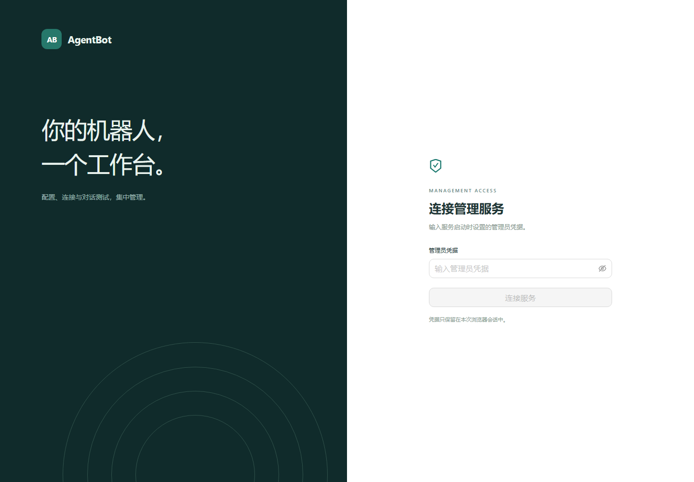

# agentBot 第一阶段迁移记录

日期：2026-10-12

## 实现范围

agentBot 位于 `D:/items/web/agentBot`，是独立安装的 Python 项目，发布包名为 `agent-bot`。当前阶段完整迁入 Chat，增加同进程的管理 API 和 React 浏览器工作台，AI 编排仍由显式配置的 Java `dispatch-ai` 服务提供。

迁入 179 个声明范围内的源码、运行资源、业务测试、fixture 和 SQL 文件，保留内部 `dispatch_chat` 包名，未通过路径注入或符号链接引用旧项目。新包和旧包的职责边界见设计文档。

界面实现：

- 管理凭据校验、退出及仅保存在内存的凭据。
- 服务依赖状态、在线机器人、保存版本和应用版本。
- 全部运行配置的类型化编辑、秘密存在状态、部分更新和冲突提示。
- 普通文本对话测试、历史消息、错误反馈与新会话。

模型供应商、Agent/Skill、MCP 客户端和任务执行的 Java 实现尚未迁到 Python。首阶段没有自动迁移生产配置、记忆、任务或 QQ 登录状态。

## API

| 方法与地址 | 行为 |
| --- | --- |
| `GET /health/live` | 公开存活状态，不暴露配置 |
| `GET /api/v1/status` | 依赖就绪、机器人数量、配置版本与需重启字段 |
| `GET /api/v1/bots` | 当前已连接机器人 |
| `GET /api/v1/settings` | 脱敏配置和字段描述 |
| `PATCH /api/v1/settings` | 部分更新，要求 `expected_revision` |
| `POST /api/v1/chat` | 普通文本测试，不授予工具、不投递 QQ 消息 |

管理 API 使用独立 Bearer 凭据。请求正文上限为 64 KiB，响应不缓存，错误带服务器生成的 request ID。校验错误和未知异常不返回输入值、上游正文或内部秘密。

配置更新沿用现有 `SettingsStore` 的完整验证和 revision 乐观锁。字段省略时保留原值，可空秘密支持显式清空，显示遮罩不能作为秘密写回。保存、热刷新和重启字段分别展示。

## 迁移来源与修改

[source-manifest.json](source-manifest.json) 记录每个原始文件的 SHA-256、迁入目的、适配及派生文件。迁移开始时后端提交为 `da11607`，使用用户当前工作区源码，保留已有本地修改。

迁入代码的定向适配包括：

1. 插件增加运行时、配置存储、配置版本、租约和就绪状态的公开观察边界。
2. 队列增加只读 `running` 属性，用于管理状态；消费和投递语义保持原有实现。
3. 重启字段名单抽取到 `dispatch_chat/runtime_fields.py`，避免管理模块导入时触发插件初始化。
4. Markdown 展示组件与 ChatMessage 契约来自原前端，补充明确类型与管理接口类型。
5. 新初始化 SQL 派生自原配置表结构，移除旧脚本的 DROP TABLE 操作。

旧仓库 GitLab 与 Helm 配置测试明确排除，它们验证原仓库部署结构，不属于本次迁入的机器人行为。没有删除其他业务测试或降低覆盖率门槛。

## 验证方式

最终验证结果：

| 检查 | 结果 |
| --- | --- |
| 完整 Python 离线测试 | 1561 通过，1 项真实 MySQL 清表测试排除 |
| Python 分支计入的整体覆盖率 | 87.34%，保留 80% 门槛 |
| Ruff 全项目检查 | 通过，临时环境与 node_modules 明确排除 |
| TypeScript 类型检查 | 通过 |
| React 行为测试 | 6 通过 |
| 前端生产构建 | 通过，主分块约 611 KiB，存在优化提示 |
| Python sdist / wheel 构建 | 通过 |
| wheel 资源及隔离安装 | 已验证两个包、运行资源、界面和 CLI；不引用旧源码 |
| 原源码完整性 | 179 项源文件摘要与迁移时一致，旧项目本地修改保留 |
| 浏览器检查 | Edge 登录页截图已查看，HTML/JS/CSS 均为 HTTP 200 |

Python 测试覆盖旧机器人行为、新管理 API、秘密保护、版本冲突、静态路由、干净进程导入和应用装配。默认验证显式排除真实 MySQL 清表环境测试，阻断机器外 socket 连接，使用 Fake MySQL、Fake Redis、ASGITransport 和 HTTP Mock。

前端测试使用真实 React 组件与 Mock HTTP 契约，验证管理员连接与退出、秘密省略、冲突后保留编辑、配置版本反馈、真实回复和请求失败恢复。另在本机 Edge 无头浏览器检查登录页面，静态 HTML、JavaScript 和 CSS 均返回 HTTP 200。

wheel 校验两个 Python 包、机器人 JSON 和构建后的界面资源；临时隔离环境安装 wheel 后验证导入路径来自该环境、应用安全导入、资源读取及 Python/console CLI 帮助。不需要旧源码目录或 Node.js 提供已打包界面。

## 执行中的取舍

- 使用用户指定的独立 agentBot 目录；这里没有 Git 历史，因此不创建 Git worktree、不提交、不推送，保留本地执行记录。
- 按已确认的计划顺序执行且不委派子代理；最终代码审查是单独的一轮作者自查，缺少独立审查者。
- 为准确观察就绪状态增加只读队列属性；不修改队列业务行为。
- 管理接口增加正文限制与错误关联标识；机器人和 MCP 协议不经过此管理中间件。
- Windows asyncio 使用本机 TCP socketpair，测试由 blanket socket 禁用改为只允许 `127.0.0.1,::1`。机器外连接仍被阻断，真实数据库清表测试明确不执行。
- 初始化使用新的安全 SQL；保留原脚本用于来源核对，不批量执行历史 SQL。
- 明确保留 Java AI，并要求独立数据库准备只包含模型标识、类型和启用状态的兼容目录；不复制供应商秘密。
- 源码迁入后的应用导入副作用由全新进程回归测试复现并修复；未知管理异常穿透问题也通过失败测试复现并修复。

## 后续范围与实际限制

没有执行真实 QQ、模型、MySQL、Redis 或外部 MCP 联调，也没有部署运行实例。开始真实运行前按 [README](../../README.md) 准备引导配置与数据。启用远程机器人工具时，还需将 Java AI 的 Chat MCP 地址指向新实例。

前端构建有约 611 KiB 的主 JavaScript 分块，构建成功，但 Vite 提示可进一步拆分；本阶段保留为性能优化事项。当前界面与消息处理单实例运行，多实例部署与桌面安装包不在本阶段范围。

旧项目保持完整，可按 README 的消费者停机与连接切换步骤回退。本次没有创建额外聊天或修改旧项目配置。
